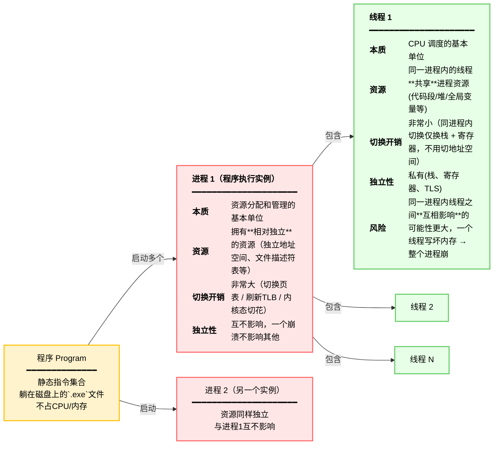
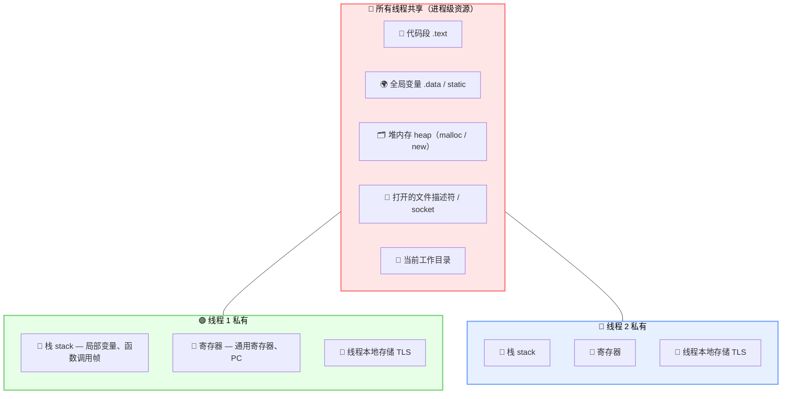

# 操作系统

## 一、程序、进程、线程的关系

> **程序 ≠ 进程**

- **程序**：是**静态的指令集合**（躺在磁盘上的 `.exe` 文件），不占用 CPU 和内存，只是一个"菜谱"。
- **进程**：是**程序的一次执行实例**，是"活的"、运行中的实体。

```
程序（Program）  →  可以启动多个进程
                    →  每个进程内包含 N 个线程
```

**示例**：双击 Chrome 3 次 → 产生 3 个进程，它们跑的是同一个 Chrome 程序，但各自独立运行。

---

### 关系图（嵌套圈圈图）



> ⚠️ **重要补充**：线程也有自己**私有**的东西 — **栈（stack）、寄存器（registers）、线程本地存储（TLS）**，不能理解为线程之间所有东西都是共享的！

---

## 二、线程间：共享 vs 私有



---

## 五、一句话记忆口诀

> 🏠 **进程是"资源房子"，线程是"干活的人"。**

| 类比         | 房子（进程）               | 人（线程）                           |
| ------------ | -------------------------- | ------------------------------------ |
| **关系**     | 各自独立，拆一间不影响隔壁 | 同住一间房，共享家具（堆、全局变量） |
| **私有物**   | —                          | 各带随身物品（栈、寄存器、TLS）      |
| **切换成本** | 搬家（切换进程）很贵       | 换个人干活（切换线程）很便宜         |
| **风险**     | —                          | 一个人乱砸东西，整间房都遭殃         |
